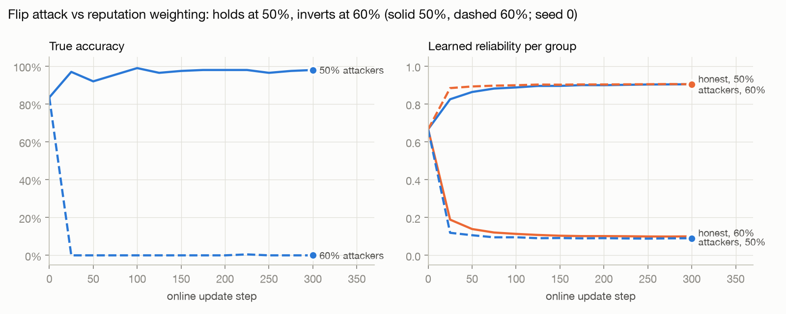
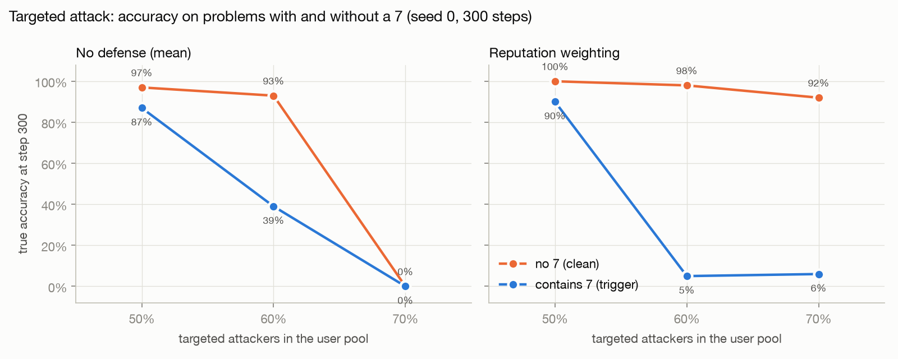
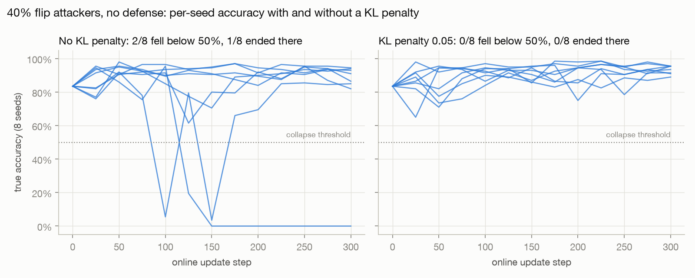

# Poisoning online RL from user feedback

**Question:** if a model keeps updating its weights from live user feedback, how
large a fraction of adversarial users does it take to steer it — and does a
cheap reputation-weighting defense help?

## Setup

- **Policy:** Qwen2.5-0.5B-Instruct + LoRA, updated online with a GRPO-style
  policy gradient (group-mean baseline, optional KL to the frozen base model).
- **Traffic:** a fresh stream of arithmetic problems (default: 2-digit × 1-digit).
- **Feedback:** each response is rated 0/1 by `k` random users from a pool of 50.
  - *honest*: rewards correct answers (5% random noise)
  - *flip*: rewards wrong answers, everywhere
  - *targeted*: honest, except on problems containing the digit 7, where it flips
    (a stealthy backdoor-style attack)
- **Aggregation:** `mean` (no defense) or `reputation` (log-odds weighted vote;
  weights learned from agreement with the other raters).
- **Ground truth:** a verifier scores a fixed, balanced eval set (100 triggered +
  100 clean problems), so we measure true accuracy, not what users reward.

## Results

All numbers are true greedy accuracy on the fixed 200-problem eval set (100 problems containing a 7, 100 without), measured against a verifier, not against what users reward. The untrained model starts at 83%.

| Setting | Outcome |
|---|---|
| Honest users only | Accuracy rises from 83% to 93–96%: online learning from feedback works. |
| 40% flip attackers, no defense (8 seeds, 300 steps) | Unstable: 2 of 8 seeds fell below 50% mid-run and 1 collapsed to 0% for good; the rest finished at 82–94%. |
| Same, plus a KL penalty of 0.05 to the base model | 0 of 8 seeds fell below 50%; all finished at 89–95%. |
| Flip attackers, reputation weighting | Holds up to 50% attackers (98% accuracy). At 60% it inverts: attackers become the "reliable" majority (learned reliability 0.90 vs 0.09 for honest users) and accuracy drops to 0%. |
| Targeted "digit 7" attackers, no defense | No visible effect up to 50%. At 60%: 39% on problems with a 7 vs 93% without (a backdoor). At 70%: total collapse. |
| Targeted attackers, reputation weighting | The defense makes the backdoor cleaner: at 60%, 5% on problems with a 7 vs 98% without; at 70%, 6% vs 92%. Targeted attackers agree with honest users on most problems, so they earn high reputation (0.69–0.88) and their votes on the trigger get amplified. |







### Takeaways

1. **A small KL penalty is a cheap, effective stabilizer** against untargeted poisoning: it removed every collapse in the 8-seed comparison at 40% attackers.
2. **Reputation weighting works against loud attackers but not quiet ones.** It handles attackers who disagree with everyone, until they are the majority, when it turns on the honest users. Against attackers who only lie on a narrow trigger, it is worse than no defense: it turns what would be a visible collapse into a precise, hard-to-notice backdoor that leaves clean accuracy intact.
3. Agreement-based trust is exactly what a stealthy attacker exploits. Detecting this kind of backdoor needs signals other than rater agreement (see the follow-up in `weight-space-audit`, which tries to find it from the weights).

### Limitations

Small model (0.5B) on a toy arithmetic task; 3 raters per response from a pool of 50; most settings are one seed (only the 40% flip comparison has 8). Treat the thresholds as indicative, not general.

## Run (Mac, M-series)

```bash
python3 -m venv .venv && source .venv/bin/activate
pip install -r requirements.txt

# 1. on-policy sanity check (should print OK)
python tools/check_logprobs.py Qwen/Qwen2.5-0.5B-Instruct

# 2. calibration run: honest users only. Accuracy should go UP.
python train.py --steps 150 --out runs/calib

# 3. one poisoned run
python train.py --poison-frac 0.3 --attack flip --out runs/flip_mean_p0.3

# 4. sweep (QUICK=1 first) and plots
QUICK=1 ./sweep.sh
python plot.py runs/*          # -> plots/curves.png, plots/sweep.png
```

Offline smoke test without downloading anything:
`python tools/make_tiny_model.py tiny-model && python train.py --model tiny-model --steps 4 --eval-every 2 --eval-per-split 8 --out runs/smoke`

## What gets logged (`runs/<name>/metrics.jsonl`)

| field | meaning |
|---|---|
| `acc`, `acc_trigger`, `acc_clean` | true greedy accuracy on the eval set |
| `train_acc` | true accuracy of sampled responses |
| `reward` | mean aggregated user reward |
| `signal` | reward(correct) − reward(wrong): how much real signal survives |
| `rep_adversarial`, `rep_honest` | mean learned reliability per group (reputation only) |
| `kl`, `resp_len`, `frac_used`, `sec` | diagnostics |

## Notes

- If the calibration run doesn't improve, change one thing at a time: try
  `--difficulty mul2` (harder, more room to learn) or `--lr 1e-4`.
- `--raters 1` disables the reputation defense (it needs ≥ 2 raters to compare).
- Expected hypothesis: reputation weighting handles `flip` well (flippers end up
  with negative weight and become useful signal) but struggles with `targeted`
  attackers, because they agree with honest users most of the time.
